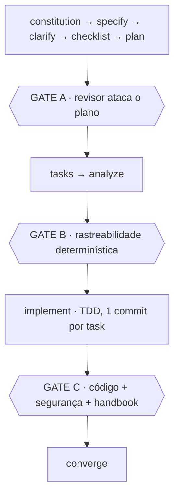

# Template — Esteira SDD com agentes + handbook de arquitetura

[](LICENSE)


Um repositório para começar (ou adotar em) qualquer projeto em que **agentes de código escrevem a maior parte do código** e o time continua no controle do que entra.

Junta duas coisas que costumam viver separadas:

- **A esteira**: Spec-Driven Development com o [GitHub Spec Kit](https://github.com/github/spec-kit), operado por agentes (Claude Code, Cursor, Copilot, Gemini CLI…), com três gates que barram retrabalho antes de gastar token de implementação.
- **O padrão**: um handbook de arquitetura em pt-BR (`docs/padroes/`) para API .NET 8 em camadas + app React 18, com templates de código prontos para copiar. Todo projeto nasce com as mesmas pastas, convenções e contratos.

> **Use este repositório como template**: botão **Use this template** no GitHub, ou copie os arquivos para um projeto existente (roteiro em [`docs/brownfield.md`](docs/brownfield.md)).

## Por que existe

Agente de código sem trilho produz rápido e diverge rápido: cada feature com uma estrutura, requisito que some no caminho, revisão que só olha o diff. Este template resolve isso com três ideias:

1. **Especificação antes de código**: toda feature vira `spec → plan → tasks`, e cada critério de aceite precisa de pelo menos uma task de teste.
2. **Gates determinísticos antes de LLM**: um script de rastreabilidade confere spec → tasks → commits sem gastar token; o revisor de IA só entra depois.
3. **Um padrão só**: o agente não inventa arquitetura, copia do handbook (`/handbook-feature` gera entidade e tela a partir dos templates).

## Como funciona



- **GATE A**: o subagente `plan-reviewer` (somente leitura) procura falhas no plano antes de existir código.
- **GATE B**: `check-traceability.ps1` precisa passar: nenhum `[NEEDS CLARIFICATION]` pendente, todo critério de aceite (`AC-001`…) referenciado em `tasks.md`, todo commit com o ID da task e varredura de segredos nos artefatos.
- **GATE C**: o subagente `code-reviewer` revisa correção, segurança e o checklist de PR do handbook.

Qualquer agente implementa sob o mesmo contrato ([`AGENTS.md`](AGENTS.md)); o Claude Code roda a esteira inteira ([`CLAUDE.md`](CLAUDE.md)).

## O que vem pronto

| | |
|---|---|
| **14 skills** do Claude Code | pipeline `speckit-*` (11), `audit` (10 focos de manutenção: bugs, dívida, segurança, docs…), `quality-protocols` (TDD, causa raiz, evidência), `handbook-feature` (scaffold) |
| **2 subagentes revisores** | `plan-reviewer` (GATE A) e `code-reviewer` (GATE C), ambos somente leitura |
| **Handbook** | 5 princípios, backend (7 guias + templates `.cs`), frontend (9 guias + templates `.tsx`/CSS), contrato API ↔ app, checklists de projeto novo e de PR |
| **CI** | `@claude` em issues/PRs, gate de rastreabilidade, painel de risco por blast radius (code-review-graph) |
| **Economia de tokens** | snapshot do código com repomix, grafo AST via MCP, skills carregadas sob demanda, CI com teto de turnos |
| **Prompts prontos** | colar no Claude Code para [projeto novo](docs/prompts/novo-projeto.md) ou [projeto existente](docs/prompts/projeto-existente.md) |

## Começando

Pré-requisitos: Windows 11 + PowerShell 7, Git, Node 18+, Python 3.10+ e, para os projetos, .NET 8 SDK e pnpm. Detalhes em [`docs/setup.md`](docs/setup.md).

```powershell
scripts/setup.ps1                       # 1x por máquina/repo: repomix, code-review-graph, ponytail, Spec Kit atual
scripts/new-feature.ps1 "descrição"     # inicia feature: branch NNN-nome + specs/ + snapshot
scripts/onboard-brownfield.ps1          # projeto existente: snapshot antes da constitution
```

| Você quer | Vá para |
|---|---|
| Criar um projeto do zero | prompt em `docs/prompts/novo-projeto.md`; checklist em `docs/padroes/checklist-novo-projeto.md` |
| Entender as 5 regras de código | `docs/padroes/principios.md` |
| Criar uma entidade na API | `/handbook-feature <Entidade> <Dominio> backend` ou `docs/padroes/backend/06-feature-completa.md` |
| Criar uma tela no app | `/handbook-feature <Entidade> <Dominio> frontend` ou `docs/padroes/frontend/03-feature-completa.md` |
| Saber o que a API devolve e o app espera | `docs/padroes/contratos/api-app.md` |
| Revisar um pull request | `.github/PULL_REQUEST_TEMPLATE.md` (checklist de `docs/padroes/checklist-pr.md` + gates da esteira) |
| Adotar em projeto existente | prompt em `docs/prompts/projeto-existente.md`; roteiro em `docs/brownfield.md` |
| Manutenção (bugs, dívida, segurança…) | `/audit <foco>` ou `/audit` (orquestrado) |

## Mapa do repositório

| Caminho | O quê |
|---------|-------|
| `CLAUDE.md` / `AGENTS.md` | contratos dos agentes (esteira completa / contrato universal) |
| `PROJECT-COMMANDS.md` | build/teste/lint canônicos, pré-preenchidos com a stack do handbook |
| `docs/padroes/` | handbook: `principios`, `backend/`, `frontend/`, `contratos/`, checklists, `recomendacoes`, `glossario` |
| `specs/NNN-nome/` | spec, plan, tasks, contracts e checklists de cada feature |
| `.specify/` | templates e scripts do Spec Kit (inclui `check-traceability.ps1`) e a `constitution.md` pré-preenchida |
| `.claude/skills/` · `.claude/agents/` | skills e subagentes revisores |
| `audits/` | logs versionados do `/audit` |
| `.github/workflows/` | CI (segredos necessários em `docs/setup.md`) |
| `.mcp.json` | MCPs padrão: repomix + code-review-graph (sem chaves); opcionais em `.mcp.json.example` |

## Economia de tokens

1. Perguntas estruturais ("quem chama isso?") vão para o **code-review-graph** (grafo AST via MCP); contexto amplo vem do **snapshot repomix comprimido**. Nunca despejar diretórios.
2. `CLAUDE.md`/`AGENTS.md` enxutos; procedimento vive em skills carregadas **sob demanda**.
3. Validação **determinística antes de LLM**: script de rastreabilidade, hooks e CI conferem de graça o que um revisor gastaria tokens conferindo.
4. Revisores rodam em **subagentes isolados** e somente leitura.
5. CI com teto: sem re-run por push, `--max-turns 15`.
6. Código mínimo por padrão (**ponytail**): `docs/padroes/principios.md` §1.
7. Medição: `npx ccusage@latest`, com baseline por feature.

## Versão do padrão

Handbook **1.3**; histórico em [`docs/padroes/CHANGELOG.md`](docs/padroes/CHANGELOG.md). Cada projeto declara no README qual versão segue. Mudança no padrão é PR aqui primeiro, depois no código dos projetos.

## Créditos

- [GitHub Spec Kit](https://github.com/github/spec-kit) (MIT): base da esteira, das skills `speckit-*` e de `.specify/`.
- [repomix](https://github.com/yamadashy/repomix) e [code-review-graph](https://github.com/tirth8205/code-review-graph): contexto de código e análise de risco.
- [Claude Code](https://docs.anthropic.com/en/docs/claude-code): skills, subagentes e GitHub Action.

## Licença

[MIT](LICENSE).
